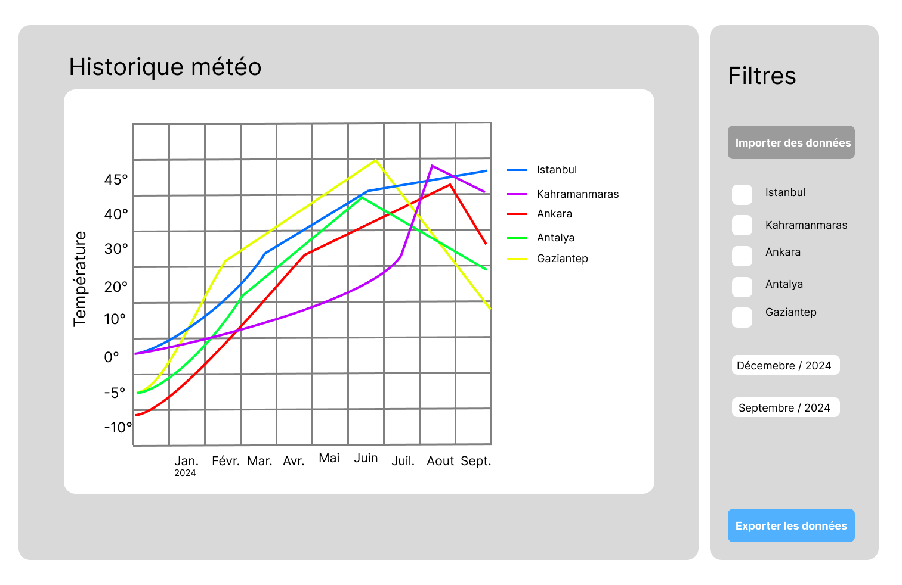

# Lancer le projet

Pour démarrer l'application, assurez-vous d'avoir installé [.NET SDK](https://dotnet.microsoft.com/) sur votre machine, puis suivez les étapes ci-dessous :

1. Ouvrez votre terminal.
2. Naviguez vers le dossier contenant le projet (le dossier 'FUN') :
```bash
cd FUN
```


3. Lancez l'application à l'aide de la commande 'dotnet' :
```bash
dotnet run
```

4. Au premier lancement le graphique est vide, il faut cliquer sur "Importer Fichier (CSV)" et choisir le fichier `FUN/Data/real_data_turkiye.csv`. Apres ca les données sont stockées en local et sont rechargées a chaque lancement.

Pour lancer les tests unitaires :
```bash
cd FUN.Tests
dotnet test
```

# Rapport - PROJET P_FUN - PLOT THOSE LINES !

**Auteur :** Ökkes Erdem Köse  
**Classe :** CID2B  
**Clients :** Xavier Carrel
**Établissement :** ETML  
**Date :** 24 Août 2026 - 30 Octobre 2026  

---

## 1. Introduction

Ce projet consiste à développer un logiciel d'analyse statistique de séries temporelles nommé **PTL (Plot Those Lines)**. L'application se concentre sur un domaine spécifique : la météorologie en Turquie. Elle permet de visualiser et de comparer simultanément l'évolution des conditions climatiques pour cinq villes distinctes : Gaziantep, Ankara, Istanbul, Antalya et Kahramanmaraş.

### 1.1 Objectifs

**Objectifs produit :**
1. Avoir une application avec une interface graphique fluide et simple a utiliser
2. Afficher et comparer 5 courbes en meme temps sur un même graphique interactif (zoom, déplacement, filtre par date)
3. Stocker les séries en local pour pouvoir travailler hors connexion
4. Pouvoir importer des nouvelles données, en ajouter a la main et exporter le graphique ou les données

**Objectifs pédagogiques :**
1. Appliquer les concepts de la programmation fonctionnelle
2. Manipuler, filtrer et traiter des données en C# en utilisant LINQ (sans boucle for)
3. Créer au moins 2 extensions du langage C#
4. Écrire des tests unitaires qui ont du sens
5. Gérer un projet seul avec des User Stories, une planification, un journal de travail et GIT

### 1.2 Description du domaine et sources de données

Le domaine d'application choisi est la Météorologie. L'objectif est d'analyser l'évolution des températures sur une période donnée pour les cinq villes turques sélectionnées.

**Cohérence des séries :** \
Les 5 séries représentent la même mesure (la température journalière en °C) sur la même période et avec le même pas de temps (1 valeur par jour). Elles partagent donc le même axe du temps et la même unité, ce qui permet de les mettre sur le même graphique. C'est intéressant de les afficher ensemble car les villes ont des climats très différents : Istanbul est au bord de la mer de Marmara, Antalya au bord de la Méditerranée, Ankara est sur un plateau au centre du pays, et Gaziantep et Kahramanmaraş sont dans le sud-est, plus continental. En les comparant on voit directement par exemple que Ankara descend beaucoup plus bas en hiver que Antalya, ou que le sud-est est plus chaud en été.

**Sources de données :** \
Au début du projet j'ai travaillé avec des données fictives générées par IA (fichier `weather_data.csv`), pour pouvoir avancer sur le code sans attendre. A la fin du projet je les ai remplacées par des vraies données de température, récupérées sur un site d'historique météo public et gratuit, puis mises au format CSV. Le fichier final est `FUN/Data/real_data_turkiye.csv`.

Le format du fichier est le suivant :

```
Date,Ville,Temperature
2025-06-01 00:00:00,Ankara,15.6
2025-06-01 00:00:00,Antalya,19.2
```

Le fichier contient 2550 valeurs, soit **510 valeurs par ville**, du 1er juin 2025 au 23 octobre 2026. Chaque série dépasse donc bien le minimum de 500 valeurs demandé.

Une fois importé, le fichier est copié dans un dossier local de l'application (`FichierIMport`), ce qui fait que l'application peut charger et afficher les graphiques de manière totalement autonome en mode hors-ligne.


## 2. Analyse fonctionnelle

Les User Stories ont été créées sous forme d'issues dans le GitHub Project du repo.

Tableau des User Stories :

| Num. | Titre | Je veux... | Afin de... |
| :--- | :------------- | :--------- | :--------- |
|  #1  | Affichage interface graphique | Je veux accéder à une interface graphique principale dès le lancement de l'application | Afin de naviguer de manière fluide et intuitive entre les différentes fonctionnalités |
|  #2  | Ajout manuel de valeurs | Je veux ajouter des valeurs supplémentaires à mes séries déja stockés localement | Afin de pouvoir tenir mes graphiques météo à jour sans devoir tout reimporter |
|  #3  | Affichage des séries | Je veux afficher simultanément les courbes de température des 5 villes (Istanbul, Ankara, Gaziantep, Kahramanmaras, Antalya) | Afin de comparer facilement les données entre ces différentes régions |
|  #4  | Navigation dans le graphique | Je veux pouvoir zoomer et me déplacer dans le graphique | Afin d'analyser les variations météorologiques sur des périodes très courtes ou très longues avec précision |
|  #5  | Importation de fichiers de données | Je veux pouvoir importer des fichiers de données au format CSV ou JSON ou via une API (json) | Afin d'intégrer de nouvelles données météo a mon application |
|  #6  | Consultation en mode hors ligne | Je veux pouvoir visualiser les graphiques de l'historique météo des 5 villes turques (Istanbul, Ankara, Gaziantep, Kahramanmaraş et Antalya) sans connexion réseau| Afin de pouvoir analyser et comparer les graphiques sans connexion Internet |
|  #7  | Exportation des données | Je veux pouvoir exporter mon graphique au format PNG et les données au format CSV | Afin de sauvegarder les données et/ou avoir un aperçu du graphique sous format image |

L'US #7 a été ajoutée pendant le projet, elle n'était pas dans la première livraison.

### 2.1 Tests d'acceptance

**US #1 - Affichage interface graphique**
- L'interface comporte un graphique principal à gauche et un panneau latéral à droite (voir maquette).
- Le panneau latéral permet d'importer/exporter des données, de cocher les villes à afficher et de filtrer par date.
- Les boutons, cases à cocher et listes déroulantes réagissent visuellement au survol et au clic.
- La disposition s'adapte au redimensionnement de la fenêtre et au plein écran.

**US #2 - Ajout manuel de valeurs**
- L'interface propose un formulaire pour ajouter une nouvelle valeur (ville, date, température).
- La nouvelle valeur s'ajoute à la série existante et est sauvegardée en local.
- Le graphique s'actualise automatiquement.
- Si la température n'est pas un nombre, un message d'erreur s'affiche et rien n'est ajouté.

**US #3 - Affichage des séries**
- Le graphique peut afficher au minimum 5 courbes en même temps.
- Chaque courbe possède une couleur distincte.
- Une légende permet d'identifier quelle couleur correspond à quelle ville.
- Une case à cocher par ville permet d'afficher ou cacher sa courbe.

**US #4 - Navigation dans le graphique**
- 2 boutons pour le zoom avant / arrière.
- Le déplacement dans le graphique est possible avec la souris.
- Un bouton permet de réinitialiser la vue pour voir toutes les données.

**US #5 - Importation de fichiers de données**
- Un bouton ouvre l'explorateur de fichiers pour choisir un ou plusieurs fichiers CSV.
- Les données importées sont converties et stockées pour être utilisables dans l'application.
- Un fichier JSON ou des données d'une API peuvent aussi être importés.

**US #6 - Consultation en mode hors ligne**
- Si l'ordinateur est déconnecté d'internet, l'application démarre normalement sans erreur.
- Au lancement hors ligne, le graphique affiche les courbes à partir des données enregistrées sur l'appareil.
- Les données importées sont sauvegardées localement sur le disque (CSV).

**US #7 - Exportation des données**
- Le fichier PNG généré correspond au rendu du graphique affiché à l'écran.
- Le fichier CSV exporté contient les bons en-têtes (Date, Ville, Temperature) et seulement les villes cochées.

### 2.2 Maquette



Nous retrouvons un simple graphique avec des données (courbes), fictives. Et a droite il y'a les actions que nous pouvons réaliser, importer ou exporter les données, afficher ou cacher chaque serie, etc.

## 3. Planification initiale

Tableau de planification :

| Num. US | Num. semaine |
| :---- | :--------- |
| Analyse, US, maquette, rapport | Semaine #1 et #2 |
| US 1 & 2 | Semaine #3 |
| US 3 & 4 | Semaine #4 |
| US 5 & 6 | Semaine #5 |
| Export (PNG/CSV) et corrections | Semaine #6 |
| Tests unitaires, extensions C#, refactor LINQ | Semaine #7 |
| Finitions, rapport final, release | Semaine #8 |

## 4. Rapport de tests

### 4.1 Tests unitaires

Les tests unitaires sont dans le projet `FUN.Tests` (xUnit). Ils testent la lecture des fichiers CSV, car c'est la base de toute l'application : si la lecture est fausse, tout le graphique est faux.

Résultat de `dotnet test` le 30.10.2026 : **3 tests réussis, 0 échec**.

| ID Test | Description / Scénario | Résultat attendu | Résultat obtenu |
| :--- | :--- | :--- | :--- |
| TU-01 | `FromCsv_TemperatureNegative_LueCorrectement` : un CSV avec une température négative (-5.5 à Ankara en janvier) | La température lue vaut -5.5 | OK |
| TU-02 | `FromCsv_CinqVilles_CinqSeriesDifferentes` : un CSV avec une ligne pour chacune des 5 villes | 5 villes différentes sont trouvées | OK |
| TU-03 | `FromCsv_SeulementEnTete_SerieVide` : un CSV qui contient seulement l'en-tête | La série contient 0 élément | OK |

### 4.2 Tests fonctionnels

Ces tests ont été fait à la main en lançant l'application, en se basant sur les tests d'acceptance.

| ID Test | US | Description / Scénario | Résultat attendu | Résultat obtenu |
| :--- | :--- | :--- | :--- | :--- |
| TF-01 | #1 | Lancer l'application | La fenêtre s'ouvre avec le graphique à gauche et le menu à droite | OK |
| TF-02 | #1 | Passer la souris et cliquer sur les boutons | Les boutons changent de couleur au survol et au clic | OK |
| TF-03 | #1 | Réduire la fenêtre et la mettre en plein écran | Le graphique s'adapte, le menu a une barre de défilement si besoin, le séparateur permet d'agrandir le menu | OK |
| TF-04 | #2 | Remplir ville, date et température puis cliquer sur "Ajouter à la série" | La valeur est ajoutée, un fichier CSV est créé en local et le graphique se met à jour | OK |
| TF-05 | #2 | Mettre "abc" comme température | Message "La température doit être un nombre valide", rien n'est ajouté | OK |
| TF-06 | #2 | Laisser le nom de la ville vide | Message d'erreur "Le nom de la ville est invalide" | OK |
| TF-07 | #3 | Importer `real_data_turkiye.csv` | 5 courbes de couleurs différentes avec une légende | OK |
| TF-08 | #3 | Décocher une ville puis la recocher | La courbe disparait puis réapparait | OK |
| TF-09 | #3 | Choisir une date de début et de fin dans le filtre | Seulement les valeurs entre les deux dates sont affichées, la vue se recadre | OK |
| TF-10 | #4 | Cliquer sur "Zoom +" et "Zoom -" | Le graphique zoome et dézoome | OK |
| TF-11 | #4 | Faire glisser le graphique avec la souris | Le graphique se déplace | OK |
| TF-12 | #4 | Cliquer sur "Recadrer la vue" | Toutes les données sont de nouveau visibles | OK |
| TF-13 | #5 | Cliquer sur "Importer Fichier (CSV)" et choisir 2 fichiers CSV | Les 2 fichiers sont copiés dans le dossier local et affichés | OK |
| TF-14 | #5 | Importer un fichier JSON ou des données d'une API | Les données sont ajoutées au graphique | Pas réalisé, seulement le CSV est pris en charge |
| TF-15 | #6 | Couper le wifi et lancer l'application après un premier import | Les courbes s'affichent normalement | OK |
| TF-16 | #6 | Lancer l'application pour la toute première fois sans avoir importé | Les courbes s'affichent | Pas OK, le graphique est vide tant qu'on a pas importé le fichier une première fois |
| TF-17 | #7 | Exporter en PNG | Une image de la taille du graphique est créée dans `ExportedFiles` | OK |
| TF-18 | #7 | Décocher 2 villes et exporter en CSV | Le CSV contient l'en-tête et seulement les 3 villes cochées | OK |

## 5. Usage de l'IA

J'ai utilisé l'IA à plusieurs moments dans ce projet, mais j'ai essayé de ne pas lui faire faire tout le travail, parce que le but c'était quand meme d'apprendre la programmation fonctionnelle et LINQ.

Au début du projet, je l'ai utilisée pour générer des données fictives de température pour les 5 villes. Je n'avais pas encore trouvé de vraies données et je voulais pouvoir tester l'affichage des courbes avec ScottPlot rapidement. C'est noté dans le commit "Ajout de données fictives (Génerés par IA)". A la fin j'ai remplacé ces données par des vraies données.

Je l'ai aussi utilisée comme une sorte de documentation, pour comprendre comment marche Avalonia et ScottPlot, car je n'avais jamais utilisé ces deux librairies avant. Par exemple pour savoir comment ajouter un graphique dans la fenêtre, comment afficher les dates sur l'axe du bas ou comment ouvrir l'explorateur de fichiers pour l'import.

Ensuite, je l'ai utilisée pour m'aider à remplacer mes boucles foreach par du LINQ. Je lui ai demandé de m'expliquer comment faire avec des méthodes comme Where, Select, SelectMany ou GroupBy, et elle m'a fait un petit document avec des exemples avant/après. Ca m'a aidé à comprendre que LINQ est "paresseux" et qu'il faut parfois faire un ToList() pour que le code s'exécute au bon moment, par exemple dans un try/catch.

Pour finir, je l'ai utilisée pour régler des problèmes de l'interface, surtout le responsive et la barre de défilement du menu, parce que je bloquais dessus et que ca ne fonctionnait pas comme je voulais.

A chaque fois j'ai relu le code proposé et je l'ai adapté à mon projet, pour etre capable de l'expliquer. Je pense que l'IA m'a fait gagner du temps sur les parties ou je ne connaissais rien, mais le défaut c'est qu'on peut vite avoir du code qu'on ne comprend pas si on fait juste du copier coller, donc j'ai fait attention à ca.

## 6. Bilan du déroulement du projet

### 6.1 Méthodologie

J'ai travaillé avec des User Stories que j'ai mises dans un GitHub Project sous forme d'issues, avec un statut (Ready, Done). Chaque cours commençait par un daily scrum. J'ai tenu un journal de travail (`Jdt-P_FUN.xlsx`) avec la durée de chaque tâche. Le code est sur GitHub et j'ai essayé de faire des commits avec un préfixe (feat, fix, doc, chore) pour que l'historique soit lisible.

### 6.2 Planning

Le planning initial n'a pas vraiment été respecté. Les semaines 1 et 2 se sont bien passées, j'ai fait l'analyse, les US, la maquette et la première version du rapport dans les temps. La semaine 3 j'ai mis en place le projet avec Avalonia et ScottPlot, le parser et la classe Weather.

Ensuite j'ai pris du retard : en semaine 4 j'étais absent une partie du cours, en semaine 5 c'était congé et en semaine 6 j'avais une journée d'information. Du coup les US 3 à 6 qui étaient prévues pour les semaines 4 et 5 ont été finies beaucoup plus tard. L'import, l'export et le stockage local ont été faits début octobre, et l'ajout manuel, le zoom, le filtre par date, les tests unitaires et les extensions ont été faits seulement à la fin, les 26 et 30 octobre.

Au total j'ai passé environ 17h30 sur le projet d'après mon journal de travail, pour 24 périodes prévues.

### 6.3 Problèmes rencontrés

- **Livraison intermédiaire :** je n'ai pas fait la livraison demandée pour l'évaluation à 80%, donc elle n'a pas pu être faite. C'est un vrai manque de ma part, j'aurais du faire une release meme si tout n'était pas fini.
- **Commits oubliés :** une fois j'ai oublié de commit tout ce que j'avais fait pendant le cours, j'ai du prendre du temps le cours d'après pour le faire.
- **Découverte d'Avalonia :** c'était la première fois que je l'utilisais, j'ai perdu du temps sur la mise en page et les couleurs du menu.
- **Passer des boucles à LINQ :** au début j'écrivais tout avec des foreach par habitude, j'ai du refaire une partie du code pour utiliser LINQ.
- **Les données :** trouver des vraies données pour 5 villes avec plus de 500 valeurs chacune et au bon format m'a pris du temps, c'est pour ca que j'ai d'abord utilisé des données fictives.

## 7. Bilan produit

### 7.1 Ce qui a été réalisé

| Fonctionnalité demandée | État |
| :--- | :--- |
| Stockage local des séries pour travailler hors connexion | Fait (dossier `FichierIMport`) |
| Ajouter des valeurs aux séries stockées | Fait (formulaire d'ajout manuel) |
| Importer des données (CSV) | Fait, avec plusieurs fichiers en meme temps |
| Importer du JSON / JSON d'une API | Pas fait |
| Afficher plusieurs séries en meme temps | Fait, 5 courbes avec légende et cases à cocher |
| Flexibilité d'affichage | Fait : zoom, déplacement, recadrage, filtre par date |
| LINQ | Utilisé presque partout (chargement, doublons, regroupement par ville, filtre, export) |
| 2 extensions C# | Fait : `IsCsv()` sur `string` et `ToCsvLine()` sur `Weather` (fichier `Extensions.cs`) |
| Librairie graphique | Avalonia |
| Librairie pour les données | ScottPlot |
| 3 tests unitaires | Fait, 3 tests qui passent |

**Ajouts personnels :**
- Export du graphique en PNG et des données en CSV (seulement les villes cochées)
- Filtre par date (du ... au ...)
- Bouton "Actualiser" qui recharge les fichiers et resynchronise les fichiers sources modifiés
- Les doublons (meme ville et meme date) sont enlevés, c'est la valeur la plus récente qui est gardée
- Messages affichés dans le menu pour dire à l'utilisateur ce qui s'est passé (import, export, erreurs)
- Le menu peut etre agrandi ou réduit avec un séparateur

### 7.2 Ce qui manque ou peut etre amélioré

- L'import JSON et via une API n'a pas été fait, seulement le CSV.
- Au tout premier lancement le graphique est vide, il faut importer le fichier une fois. Il faudrait charger le fichier `Data/real_data_turkiye.csv` automatiquement si le dossier local est vide.
- Dans `DataSeries.cs`, la méthode `FromCsv` utilise encore un `foreach`, il faudrait la passer en LINQ (Skip / Where / Select) comme le reste du code.
- Le chemin du dossier d'import est écrit 3 fois dans `MainWindow.axaml.cs`, il faudrait le mettre dans une constante.
- Il reste le texte "Menu aa" en haut du menu qui est un reste de test.
- Les tests unitaires testent seulement la lecture du CSV, on pourrait ajouter des tests sur les extensions et sur le filtre par date.

## 8. Conclusion

Ce projet m'a permis de faire une vraie application de A à Z, de l'analyse avec les User Stories jusqu'aux tests. L'application fait l'essentiel de ce que le client voulait : on peut afficher les températures des 5 villes turques sur le meme graphique, les comparer, zoomer, filtrer par date, ajouter des valeurs, importer et exporter, et tout marche hors connexion.

Techniquement, j'ai surtout appris à utiliser LINQ à la place des boucles. Au début c'était pas naturel pour moi, mais à la fin je trouve que le code est plus court et plus facile à lire, par exemple pour enlever les doublons avec un GroupBy ou pour regrouper les données par ville. J'ai aussi découvert Avalonia, ScottPlot, les méthodes d'extension et les tests avec xUnit.

Par contre au niveau de la gestion de projet ce n'était pas bon. J'ai pris beaucoup de retard, une grande partie du travail a été faite à la fin et j'ai raté la livraison intermédiaire. Pour les prochains projets je dois commit plus souvent, faire les livraisons meme si tout n'est pas fini et mieux répartir le travail sur toutes les semaines au lieu de tout faire à la fin.
